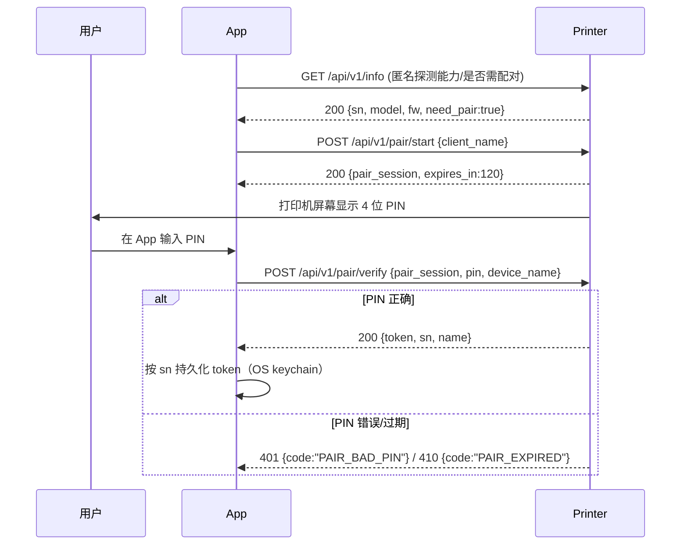
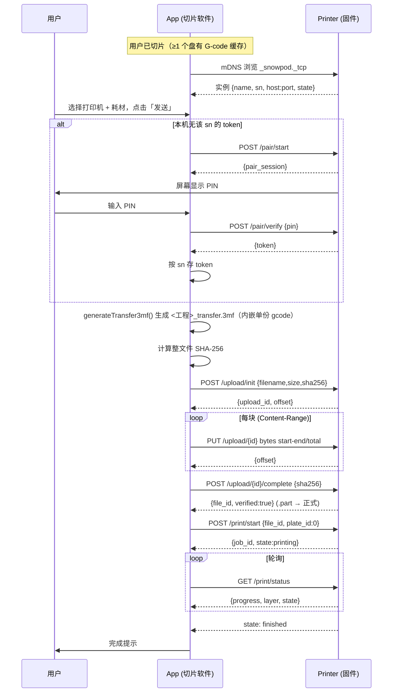

# WiFi 无线传输协议说明（WIFI-TRANSFER）

> **范围说明**：本文件为《WIFI-TRANSFER》的**打印设备 HTTP 协议**部分（§0–§13），
> 面向打印机固件 / 设备端开发团队；云端服务端协议（登录鉴权与模型接口，原 §14）
> 已拆分至 `WIFI-TRANSFER-CLOUD.md`，两份文档并行维护。

> 本文档定义 **Snowpath 客户端（PC 端切片软件 + 移动端 App）** 与 **打印机固件
> （服务端 / Printer）** 之间，通过网络把「切片好的打印任务」无线发送到打印机的
> 完整协议：设备发现、配对鉴权、传输数据格式、上传 / 打印 / 状态 REST 接口、
> 错误码、安全模型与职责划分。**连接只要求客户端到打印机 `IP:8080` 网络可达
> （不限同一局域网；mDNS 自动发现仅同网段有效，跨网用手动 IP），云端不对接
> 打印机、不中转模型。**
>
> 本文已将早期所有「待定项」按**最小 / 最省事的 v1 方案**定稿（详见附录
> 变更说明）。标注 **【约定】** 的即为**最终默认值**，两端据此实现即可，无需
> 再确认。被降级的更强方案统一收进「§12 未来扩展（可选，非 v1）」。文末
> 「§11 现状与待办」严格按当前仓库代码描述哪些已具备、哪些仍是占位 / 待实现，
> 请勿据未实现部分写集成代码。

---

## 0. 一句话定位

- **客户端 = 连接打印机的上位机**，最终**只有两类**：① **PC 端软件**（切片软件，
  本仓库 `app_framework`）、② **移动端 App**。两类客户端**复用同一套本文协议**
  （mDNS 发现 + HTTP REST + 传输 3mf 上传 + 打印控制 / 状态），地位对等。客户端
  负责生成 / 持有「传输 3mf」（内嵌当前盘的一份已切片 G-code），作为 HTTP 客户端把
  文件**分块上传**到打印机、下发开始打印指令、轮询打印状态。
- **服务端 = 打印机固件**：负责通过 mDNS 广播自己、处理 PIN 配对并颁发
  Token、接收分块上传并校验落盘、执行打印、上报状态。
- **整体数据流**：`发现/手动指定打印机 → (首次)PIN 配对拿 Token → 客户端持有
  传输 3mf → 分块上传并整体校验 → 下发开始打印 → 轮询状态直到完成`。

> **【架构定调】** 模型 / G-code 到打印机的传输**永远是「客户端（PC / 移动端）
> → 打印机」的直接网络连接**：**只要客户端能通过网络访问到打印机的 `IP:端口`
> （默认 8080）即可**，**不限于同一局域网**（同网段、跨网段路由可达、VPN 打通、
> 点对点可达等都行）。**云端不直接与打印机交互，也不向打印机传输 / 中转模型**
> ——不存在「云 → 打印机」的模型下发 / 对象存储拉取路径。云端（如有）只承担与
> 打印机传输无关的职责（账号、模型市场等），**不在本传输协议范围内**（云端
> 服务端的登录鉴权与模型接口信息见《WIFI-TRANSFER-CLOUD.md》）。
>
> **发现 vs 连接**：mDNS（`_snowpod._tcp`）**自动发现仅在同一局域网网段内有效**
> （组播不跨网段）；非同网段 / mDNS 不通时，用**「手动添加 IP（默认 8080）」**
> 直接连接，REST / 上传 / 打印 / 状态照常工作。即「发现」可能受限于局域网，但
> 「连接与传输」只要求**网络可达**。

为什么这么分：切片是重算力 + 大内存任务，只能在 PC 端做（移动端则发送已备好的
传输 3mf）；打印机固件资源受限，只承担「收文件 + 执行 + 报状态」。把已切片产物
打包成自描述的传输 3mf 发过去，固件无需具备切片能力，也便于断点续传与校验。

---

## 1. 术语与角色

| 术语 | 含义 |
| --- | --- |
| **Client / App** | 连接打印机的上位机，**仅两类**：PC 端切片软件（本仓库 `app_framework`）与移动端 App，复用同一套本文协议 |
| **Server / Printer** | 打印机固件，提供 mDNS + HTTP 服务端 |
| **云端 / Cloud** | 账号、模型市场等服务，**不直接对接打印机、不参与模型传输**；其登录鉴权与模型接口见《WIFI-TRANSFER-CLOUD.md》 |
| **Plate（盘）** | 一个打印床布局单元；当前每个传输包只发送一个盘 |
| **传输 3mf** | ZIP 容器，内嵌当前盘的一份已切片 G-code（见 §5），上传单元 |
| **PIN** | 打印机屏幕显示的一次性配对码（**【约定】4 位数字**），物理在场凭证 |
| **Token** | 配对成功后固件颁发的长期访问令牌，后续请求免再输 PIN |
| **Job（任务）** | 一次打印任务，服务端为每次上传 + 打印分配一个 `job_id` |
| **SN** | 打印机序列号，设备唯一标识 |

---

## 2. 概览与架构

> 拓扑只有一条传输路径：**客户端（PC 端软件 / 移动端 App）—网络可达→ 打印机**
> （`IP:8080` 能连通即可，不限同一局域网）。两类客户端对等、复用下图同一套协议；
> **云端不在此图中**（不与打印机直连、不传模型）。图中 ① mDNS 发现仅同网段有效，
> 跨网段 / mDNS 不通时以「手动添加 IP」代替，② / ③ 的 REST 只要 IP 可达即可。

```
┌──────────────────── 客户端（PC 端软件 / 移动端 App，复用同一协议）─────────────────┐
│  Layout::generateTransfer3mf ──> ProjectIO::saveTransfer3mf  (传输 3mf 生成)      │
│  SendPrintTaskDialog / PrinterPairDialog            (发送 / PIN 配对 UI)          │
│  [待实现] DeviceDiscovery (mDNS)  PrinterClient (REST)  FileUploader (分块上传)   │
└───────────────┬───────────────────────────────────────────────┬─────────────────┘
                │  ① mDNS 发现 (_snowpod._tcp)                    │  ③ HTTP REST
                │  ② PIN→Token 握手 (HTTP)                        │     上传/打印/状态
┌───────────────┴───────────────────────────────────────────────┴─────────────────┐
│                          服务端（打印机固件 / Printer）                            │
│  mDNS Responder   |  Pair/Token 服务   |  Upload 接收+校验+落盘  |  打印执行+状态  │
└──────────────────────────────────────────────────────────────────────────────────┘
```

- **传输层**：HTTP/1.1（明文）。**【约定】** 固定服务端口 `8080`，客户端只要
  网络可达该 `IP:8080` 即可（不限同一局域网）。v1 不上 TLS，纯 HTTP + Token
  鉴权即可（HTTPS 见 §12；跨公网等不可信链路建议后续启用 TLS）。
- **数据编码**：控制类接口用 JSON（UTF-8）；文件上传用二进制 body +
  `Content-Range` 分块。
- **鉴权**：除发现与配对握手外，所有接口都需携带 `Authorization: Bearer
  <token>`。

---

## 3. 设备发现（mDNS / DNS-SD）

> **【适用范围】** 本章的 mDNS **自动发现仅在同一局域网网段内有效**（组播 224.0.0.251
> 不跨网段）。**跨网段 / VPN / mDNS 被隔离时，改用 §3.3 的「手动添加 IP（默认 8080）」**
> 直接连接——只要客户端到打印机**网络可达**，§4 配对与 §6 上传 / 打印 / 状态全部照常。
> 即：**自动发现可能受限于局域网，但连接与传输只要求 IP 可达。**

### 3.1 服务类型与实例

- **服务类型**：**【约定】** `_snowpod._tcp`（局域网 `.local` 域）。
- **实例名**：**【约定】** 取打印机用户可读名，例如 `Snowpod-A1 (lab)`；冲突
  时由 mDNS 标准自动追加 ` (2)`。
- **端口**：**【约定】** 固定 `8080`（SRV 记录照常给出，便于非默认部署，但
  v1 客户端默认按 8080 连接）。
- **主机名**：**【约定】** `snowpod-<sn>.local`，**暴露 SN**——`sn` 同时用于
  mDNS 区分设备与客户端 Token 存储键，不另设设备 id（局域网内可识别即可，
  见 §9 隐私说明）。

### 3.2 TXT 记录字段（键值，全部小写，**最小集**）

| Key | 示例 | 含义 |
| --- | --- | --- |
| `ver` | `1` | 协议版本（本文件 = 1） |
| `model` | `Snowpod A1` | 机型，UI 展示用 |
| `sn` | `SP1A23456789` | 序列号，设备唯一键（重连 / 去重 / Token 存储键） |
| `needpair` | `1` / `0` | 是否需要配对（`0` 表示本机已配过、可免 PIN） |

> **【约定】** TXT 仅这 4 个字段，固件版本 / 实时状态等不放进 TXT（需要时走
> `GET /info`，见 §4.2.1），保持广播包精简。客户端以 `sn` 作为设备身份主键来
> 匹配「已保存的 Token」，而非 IP（IP 会变）。

### 3.3 发现、下线与超时

- **发现**：客户端启动「发送到打印机」流程时开始浏览 `_snowpod._tcp`，把每个
  实例解析为 `{name, model, sn, host, port}` 填进打印机下拉（实时状态需要时再
  按 `GET /info` 拉取）。
- **下线**：收到 mDNS `goodbye`（TTL=0）或解析失败 → 从列表移除。
- **超时**：**【约定】** 浏览 5s 无响应仍允许手动刷新；某设备 30s 未刷新 TXT
  视为离线。
- **手动连接（非兜底，是平级入口）**：**【约定】** UI 在打印机下拉旁提供
  「+ 手动添加」入口，输入 `IP[:端口]`（端口缺省即 8080），跳过 mDNS 直接走
  §6 的 HTTP 接口。**只要该 `IP:端口` 网络可达即可**——适用于跨网段、VPN、
  点对点等 mDNS 发现不到、但 IP 仍连得通的所有场景。

> 上游可参考 `3rd/slice/slic3r/Utils/Bonjour.cpp` 的 mDNS 浏览实现作为客户端
> 发现侧的落地参考。

---

## 4. 配对与鉴权（PIN → Token）

### 4.1 流程



### 4.2 端点定义

#### 4.2.1 `GET /api/v1/info`（匿名，能力探测）

响应：

```json
{ "sn": "SP1A23456789", "model": "Snowpod A1", "fw": "1.4.2",
  "api_version": 1, "need_pair": true, "state": "idle" }
```

#### 4.2.2 `POST /api/v1/pair/start`（匿名，开始配对）

请求 body：

```json
{ "client_name": "Snowpath @ Alice-PC" }
```

响应（同时打印机屏幕显示 PIN）：

```json
{ "pair_session": "9f2c…", "expires_in": 120 }
```

#### 4.2.3 `POST /api/v1/pair/verify`（匿名，校验 PIN + 命名 + 颁发 Token）

**【约定】** 设备命名一并在本端点完成（**不单设 `PUT /name` 端点**）：客户端
把用户在「成功命名」态填的设备名 `device_name` 随校验请求一起提交，固件校验
PIN 通过后保存该别名并在响应里回带。

请求 body：

```json
{ "pair_session": "9f2c…", "pin": "1234", "device_name": "实验室-A1" }
```

成功响应（`name` = 固件最终采用的别名，通常即提交的 `device_name`）：

```json
{ "token": "eyJhbGci…(不透明长期令牌)", "sn": "SP1A23456789",
  "name": "实验室-A1" }
```

失败：`401 PAIR_BAD_PIN`（PIN 错，允许重试，**【约定】** 最多 5 次后锁定
`pair_session`）；`410 PAIR_EXPIRED`（会话超时，需重新 `pair/start`）。

> `device_name` 可选：客户端不命名时省略该字段，固件回退为 `model` 作为
> `name`。
>
> **【v1 实现说明】** 打印机出厂即自带固有身份（`model` 型号 + `sn` 序列
> 号，见 `/info` 与 mDNS TXT），固件无需用户昵称来标识自己。因此 v1 客户端
> 将用户在「成功」态起的名字仅作为**客户端本地显示名**（按 `sn` 持久化于
> `PrinterTokenStore`），`pair/verify` **不提交** `device_name`，固件回退为
> `model`。`PrinterClient::pairVerify` 仍保留 `device_name` 参数，若未来需要
> 让固件记录昵称，把命名步骤前置到 PIN 输入页一起提交即可零成本对齐。

### 4.3 Token 存储、免输与解除

- **存储**：客户端按 `sn → token` 存入 OS keychain（与 `docs/ONLINE-MODELS.md`
  的 token 存储一致原则，不落明文配置）。
- **免输**：下次发送，若本机已有该 `sn` 的有效 token，直接跳过 PIN 配对进入
  §6 上传。
- **失效**：任何业务接口返回 `401 AUTH_INVALID` → 客户端丢弃本地 token，回退
  到 §4.1 重新配对。
- **解除配对**：`POST /api/v1/pair/revoke`（带 Token）使当前 token 失效；
  打印机端「设置 → 解除已配对设备」也应能单方作废。**【约定】** 固件按
  `client_name` 保存多个 token（天然支持多客户端配对，无需客户端做 token
  管理 UI）；客户端侧只需在收到 `401 AUTH_INVALID` 时丢弃本地 token 重新配对。

### 4.4 与现有 PIN UI 的对齐

当前 `PrinterPairDialog` 已实现 4 状态 UI（输入 PIN → 搜索 → 成功命名 →
失败），但**是假实现**：PIN `== "1234"` 即视为正确、用本地 `QTimer` 模拟
3s「搜索」后转成功，无任何网络请求。落地时需把：

- 「搜索」态从 **假倒计时** 改成真正发 `pair/start` + 等待用户输入 + 发
  `pair/verify`；
- 「成功」态的「命名设备」**v1 仅作客户端本地显示名**：打印机出厂已知自己
  的 `model`/`sn`，无需回传昵称，故 `pair/verify` 不带 `device_name`，名字按
  `sn` 持久化于本地（详见 §4.2.3 的 v1 实现说明）；
- `paired(pin)` 信号语义改为「已拿到 token」，再继续 §6 上传。

---

## 5. 传输数据格式（传输 3mf）

### 5.1 精确结构

传输 3mf 本身是 ZIP 容器。当前 Windows 客户端发送的实测样例为：

```
<project>_transfer.3mf
├── 3D/<project>.gcode                     ← ★ 已切片、可直接打印
├── Metadata/<project>.json                ← 盘/层/材料等元数据（本期不导入）
└── Thumbnails/<project>.png               ← 缩略图（板端导入并生成 RTHM）
```

- **G-code 条目**：正式路径为 `3D/*.gcode`；板端同时兼容早期草案曾约定的
  `Metadata/*.gcode`。
- **单盘**：当前板端要求包内必须且只能有一份 G-code；没有或多于一份均拒绝，
  不依赖 `/print/start` 的 `plate_id` 选盘。
- **完整性**：上传协议校验整包 SHA-256，解压再校验 ZIP CRC 和条目大小。实测
  客户端样例不含 `.gcode.md5`，故本期不要求 MD5 条目。
- **G-code 内容**：SLM 工艺文本，由 `SlicingOrchestrator::writeGCodeFile()` 经
  `RSSlicer::emitGCodeLayer` 按层生成，文件头形如 `; SLM GCode - Snowpath`，
  含层数 / 层高 / 扫描速度 / 各段激光功率等注释。

板端导入后，原始 3MF 保留在 `/userdata/transport`；可打印体以
`<上传包名去后缀>.gcode` 落到 `/userdata/Gcode`，并更新
`/userdata/Gcode/config.json`。用户从打印机 Local 列表选择后，复用现有
GcodeWorker 打印，不再运行 snowslice。

缩略图导入约定：

- 优先使用与 G-code 同 stem 的 `Thumbnails/*.png`；包内只有一张 PNG 时
  直接使用。多图且无法唯一匹配时按无图降级。
- 原 PNG 保存到 `/userdata/image/gcode/<上传包名去后缀>.png`。
- 板端从该 PNG 生成 `*_small.rthm`（72×72）、`*_large.rthm`
  （320×180）、`*_print.rthm`（100×100），并将绝对路径写入
  `thumb_small`、`thumb_large`、`thumb_print`。RTHM 是项目自定义的
  RGB565 文件格式；RGA 只负责加速 COVER 裁剪、缩放和像素格式转换，
  不可用时由 CPU 兜底。
- 缺图、坏图或图片转换失败不影响 G-code 导入，三个缩略图字段留空并记录
  `topic_xfr_upload.log` 告警。同名重传会清理不再有效的旧图；删除 Local
  打印文件时同步删除其 PNG/RTHM。

### 5.2 与普通另存 3mf 的区别

| | 普通工程 3mf（`save3mf`） | 传输 3mf（`saveTransfer3mf`） |
| --- | --- | --- |
| 模型 + 变换 + 多盘 + sidecar | ✅ | 当前实测传输包不包含 |
| `3D/*.gcode` | ❌ 不含 | ✅ 当前只允许一份 |
| 用途 | 工程存档 / 再编辑 | 发送到打印机执行 |
| 落盘位置 | 用户选择的工程路径 | 缓存目录 `<Cache>/transfer/<工程名>_transfer.3mf` |

普通保存语义**不变**（不含 gcode）；传输 3mf 是独立新增产物。

### 5.3 前置校验

客户端生成时必须保证 G-code 非空。板端仍独立校验：ZIP 结构及路径安全、条目数、
压缩方法、解压大小/压缩比、CRC；失败时不更新 Local 清单。

---

## 6. 传输协议（HTTP REST）

所有接口基路径 **【约定】** `/api/v1`；除 §4 配对外均需
`Authorization: Bearer <token>`。

**【响应结构约定】** 所有接口遵循同一套返回规范：

- **成功**：HTTP `200`，响应体直接返回该接口的数据对象，**没有统一的
  `code` / `message` / `data` 外层包裹**；各字段即该接口自己的字段。例如
  `/info` 返回 `sn/model/...`，`/print/status` 返回 `job_id/progress/...`，
  `/print/pause` 返回 `job_id/state`。
- **失败**：HTTP 为对应语义状态码（4xx / 5xx），响应体统一为：

```json
{ "code": "AUTH_INVALID", "message": "Token 已失效" }
```

- `code` 为机器可读错误码（见 §8.1），`message` 为可读描述。网络层失败
  （没有 HTTP 响应）时无 body，客户端按 §8.2 的本地 / 传输层码处理。

### 6.1 上传（分块 + 断点续传 + 整体校验 + 原子落盘）

设计与客户端现有 `FileDownloader`（§见参考）**对称**：分块、续传、整体哈希、
进度、`.part → 正式` 原子落盘——只是方向相反（上传）。

#### 6.1.1 创建上传会话 `POST /api/v1/upload/init`

请求：

```json
{ "filename": "demo_transfer.3mf",
  "size": 10485760,
  "sha256": "<整文件 SHA-256 hex 小写>",
  "kind": "transfer_3mf" }
```

响应：

```json
{ "upload_id": "u_8123", "offset": 0, "chunk_max": 4194304 }
```

- `offset` = 服务端**已收到的字节数**（断点续传基线）。新会话为 0；若客户端
  用同一 `sha256` 重新 init，服务端可返回上次进度的 `offset` 实现跨重启续传
  （**【约定】** 服务端以 `sha256` 作为去重 / 续传键）。
- `chunk_max` = 单块字节上限（**【约定】** 默认 4 MiB）。

> **【约定】** 整文件完整性用 **SHA-256**（与 `FileDownloader` 一致，更强）；
> 传输 3mf 内部还使用 ZIP CRC 校验解压内容；当前客户端样例没有单独的 MD5
> 条目。

#### 6.1.2 上传分块 `PUT /api/v1/upload/{upload_id}`

Header：

```
Authorization: Bearer <token>
Content-Range: bytes <start>-<end>/<total>
Content-Type: application/octet-stream
```

Body：该区间的原始字节。

响应（每块）：

```json
{ "offset": 4194304 }      // 服务端当前已落盘的累计字节（= 下一块的 start）
```

- 客户端按 `offset` 顺序推进；网络中断后重新 `upload/init`（或直接 `GET
  upload/{id}/status`）拿最新 `offset` 续传。
- 服务端把分块写入 `<filename>.part`（**临时**），记录已收字节。

#### 6.1.3 完成并校验 `POST /api/v1/upload/{upload_id}/complete`

请求：

```json
{ "sha256": "<整文件 SHA-256 hex 小写>" }
```

服务端对 `.part` 整体算 SHA-256：
- 匹配 → **原子 rename** `.part → 正式文件`，返回 `200`：

```json
{ "file_id": "f_5566", "size": 10485760, "verified": true }
```

- 不匹配 → 删除 `.part`，返回 `422 CHECKSUM_MISMATCH`，客户端需重传。

#### 6.1.4 查询上传进度 `GET /api/v1/upload/{upload_id}/status`

```json
{ "offset": 8388608, "size": 10485760, "state": "receiving" }
```

> **进度**：客户端上传进度 = `已发送字节 / total`（续传时叠加初始 `offset`），
> 与 `FileDownloader` 的进度叠加逻辑对称。

### 6.2 开始打印 `POST /api/v1/print/start`

请求（指定已上传文件 + 盘号）：

```json
{ "file_id": "f_5566", "plate_id": 0, "material": "耗材-002" }
```

- `plate_id` 为兼容旧客户端暂时保留；当前传输包只允许一份 G-code，本期完成
  上传后只导入 Local 清单，真正打印由板端 UI 发起。
- 响应：

```json
{ "job_id": "j_9001", "state": "printing", "plate_id": 0 }
```

- 错误：`409 PRINTER_BUSY`（已有任务在打印）；`404 FILE_NOT_FOUND`。

### 6.3 查询状态 / 进度 `GET /api/v1/print/status`

**【约定】** v1 **只采用客户端轮询**（实现简单、固件无需维持长连接），不做
WebSocket / SSE 推送（列入 §12 未来可选）。轮询间隔建议 1–2 s，打印中可放宽到
5 s。

**【板端约定】**

- 桌面端直连本机 HTTP；打印进度来自 Glavo IPC 缓存，上传/切片来自 Xfr 本地态。
- 上传/导入完成对外 `state=idle`（不是 `finished`）；`finished` 仅表示打印完成。
- 真正开打后 `job_id` 优先为延时摄影目录名 `frames_dir`（打印中多为 `tmp`）。
- `chamber_temp` 有舱温读数；`nozzle_temp` / `bed_temp` / `laser_power` /
  `blower_*` / `filament_*` / `layer_height` 本期固定 `0`。

```json
{
  "job_id": "j_9001",
  "state": "printing",
  "progress": 0.42,
  "layer": 128,
  "layer_total": 305,
  "layer_height": 0.2,
  "elapsed_s": 540,
  "remaining_s": 720,
  "filament_total_g": 1250,
  "filament_used_g": 620,
  "nozzle_temp": 0,
  "bed_temp": 0,
  "chamber_temp": 250,
  "laser_power": 1000,
  "blower_speed": 1000,
  "blower_state": 0,
  "blower_error": 0,
  "error": null
}
```

字段说明：

- `job_id`：任务 ID。
- `state`：打印状态，取值见下方约定。
- `progress`：打印进度，归一化 [0,1]，`0.42` 即 42%。
- `layer`：当前层号（正在打印第几层）。
- `layer_total`：总层数。
- `layer_height`：层高，单位毫米（mm）。
- `elapsed_s`：已用时间，单位秒。
- `remaining_s`：剩余时间，单位秒。
- `filament_total_g`：本次任务预计耗材总量，单位克。
- `filament_used_g`：已用耗材，单位克。
- `nozzle_temp`：喷嘴温度，单位 0.1 ℃。
- `bed_temp`：基板温度，单位 0.1 ℃。
- `chamber_temp`：舱内温度（腔体温度），单位 0.1 ℃，`250` = 25.0 ℃，必填。
- `laser_power`：激光功率（百分比），单位 0.1 %，`1000` = 100.0 %。
- `blower_speed`：风机转速，单位 rpm。
- `blower_state`：风机状态。`0`=停止，`1`=启动，`2`=运行，`3`=重试等待，`4`=故障锁定。
- `blower_error`：风机故障码。`0`=无故障，`1`=Hall 非法，`2`=Hall 错序，`3`=堵转，`4`=过流，`5`=欠压，`6`=过压，`7`=超速。
- `error`：错误态时的可读原因；非 error 态为 `null`。

`state` 取值 **【约定】**：`idle | uploading | printing | paused | finished |
canceled | error`。

### 6.4 取消打印 `POST /api/v1/print/cancel`

```json
{ "job_id": "j_9001" }
```

→ 终止当前任务并清理，响应 `200 {"job_id":"j_9001","state":"canceled"}`。

> **【约定】** 取消为终止动作，一旦执行不可恢复；仅临时停止请使用 §6.5 暂停打印 / §6.6 恢复打印。

### 6.5 暂停打印 `POST /api/v1/print/pause`

暂停当前打印任务：打印执行暂停，任务进入 `paused` 状态。

```json
{ "job_id": "j_9001" }
```

- `job_id`：要暂停的打印任务 ID（必填，仅此一参）。
- 响应：

```json
{ "job_id": "j_9001", "state": "paused" }
```

- 错误：`404 JOB_NOT_FOUND`（任务不存在）；`409 JOB_NOT_PRINTING`（当前任务不是
  `printing` 态，无法暂停）。

### 6.6 恢复打印 `POST /api/v1/print/resume`

恢复已暂停的打印任务，任务继续执行并回到 `printing` 状态。

```json
{ "job_id": "j_9001" }
```

- `job_id`：要恢复的打印任务 ID（必填，仅此一参）。
- 响应：

```json
{ "job_id": "j_9001", "state": "printing" }
```

- 错误：`404 JOB_NOT_FOUND`（任务不存在）；`409 JOB_NOT_PRINTING`（当前任务不是
  `paused` 态，无法恢复）。

### 6.7 拉取视频直播流地址 `GET /api/v1/video/live`

拉取打印机摄像头的当前直播推流地址（RTSP），供设备控制台实时画面播放。接口只
返回推流地址，不负责视频流中转；客户端取到 `living_url` 后交给 RTSP 播放器即可。

请求（Query）：

```text
?cloud=1
```

| 参数 | 类型 | 必填 | 说明 |
| --- | --- | --- | --- |
| `cloud` | int | 否 | `1` = 返回云端推流地址；`0` / 缺省 = 返回设备本地 / 局域网可直连地址 |

响应（存在直播推流）：

```json
{ "state": "living", "living_url": "rtsp://192.168.1.20:8554/live/snowpod" }
```

响应（暂无直播流）：

```json
{ "state": "stop" }
```

- `state`：`living` = 存在直播推流，可取出 `living_url` 直接用于直播；`stop` =
  暂无直播流，此时不返回 / 不保证 `living_url`。
- `living_url`：直播流 RTSP 地址，仅 `state=living` 时有效。
- 鉴权：**匿名**（无需 Token）。设备直播按“开盒即用”的流媒体服务器处理，不参与 §4 配对鉴权。

### 6.8 查询打印历史任务 ID 列表 `GET /api/v1/print/history`

按日期查询打印机某一天的打印历史任务 ID 列表（用于延时摄影回看等场景：客户端先
拿到当天全部 `job_id`，再按需查询单个任务的详情 / 延时视频）。

**【板端约定】** `job_ids[]` 取自 `/userdata/media/video/config.json` 的
`frames_dir`（本地目录主键），按 `start_unix` 升序；仅返回 `committed=true` 条目。
协议示例中的 `j_9001` 形式不适用于当前固件。

请求（Header + Query）：

```text
Authorization: Bearer <token>
?year=2026&month=9&day=11
```

| 参数 | 类型 | 必填 | 说明 |
| --- | --- | --- | --- |
| `year` | int | 是 | 四位年，如 `2026` |
| `month` | int | 是 | 月，`1`–`12` |
| `day` | int | 是 | 日，`1`–`31` |

响应（有记录）：

```json
{ "date": "2026-09-11", "count": 3, "job_ids": ["j_9001", "j_9002", "j_9003"] }
```

响应（无记录）：

```json
{ "date": "2026-09-11", "count": 0, "job_ids": [] }
```

- `date`：回显实际查询日期，格式 `YYYY-MM-DD`，按**打印机本地时区**统计。
- `count`：当天打印历史任务数量，与 `job_ids` 长度一致。
- `job_ids`：当天打印历史任务 ID 列表，按开始打印时间升序排列。
- 鉴权：需携带 `Authorization: Bearer <token>`。
- 错误：`422 INVALID_DATE`（年/月/日非法或日期不存在，如 `month=13`、`day=32`）。

### 6.9 按任务查询延时摄影图片列表 `GET /api/v1/print/{job_id}/timelapse/images`

选中某一打印历史记录后，按 `job_id` 分页拉取该任务的延时摄影图片 URL 列表；每条
都是可直接通过 HTTP GET 下载的文件地址（绝对路径）。

**【板端约定】** 帧文件落在 `/userdata/media/video/{job_id}/N.png`（`N` 为正整数）。
列表返回的 URL 形如 `http://{Host}/timelapse/{job_id}/1.png`（扩展名 `.png`，
与盘上一致；协议示例中的 `.jpg` / 六位补零文件名不适用于当前固件）。静态下载
路径**不校验 Token**。

请求（Header + Path + Query）：

```text
Authorization: Bearer <token>
GET /api/v1/print/j_9001/timelapse/images?page=1&page_size=50
```

路径参数：

| 参数 | 类型 | 必填 | 说明 |
| --- | --- | --- | --- |
| `job_id` | string | 是 | 打印任务 ID，来自 `print/history` 返回的 `job_ids`，如 `j_9001` |

Query 参数（分页）：

| 参数 | 类型 | 必填 | 默认 | 说明 |
| --- | --- | --- | --- | --- |
| `page` | int | 否 | `1` | 页码，从 1 开始 |
| `page_size` | int | 否 | `50` | 每页条数，建议上限 `500`，服务端可截断 |

响应（已有图片，`ready`）：

```json
{
  "job_id": "j_9001",
  "state": "ready",
  "total": 320,
  "page": 1,
  "page_size": 50,
  "images": [
    "http://192.168.1.20:8080/timelapse/j_9001/000001.jpg",
    "http://192.168.1.20:8080/timelapse/j_9001/000002.jpg"
  ]
}
```

响应（打印进行中，返回已采集部分，`capturing`）：

```json
{
  "job_id": "j_9001",
  "state": "capturing",
  "total": 8,
  "page": 1,
  "page_size": 50,
  "images": [ "http://192.168.1.20:8080/timelapse/j_9001/000001.jpg" ]
}
```

响应（无延时摄影图片，`none`）：

```json
{ "job_id": "j_9001", "state": "none", "total": 0, "page": 1, "page_size": 50, "images": [] }
```

`page` 超出范围时返回空列表、`total` 仍为真实总数：

```json
{ "job_id": "j_9001", "state": "ready", "total": 320, "page": 7, "page_size": 50, "images": [] }
```

字段说明：

- `job_id`：回显查询的任务 ID。
- `state`：`ready` = 已采集完、可完整查看；`capturing` = 打印进行中，返回当前已采集部分；`none` = 该任务无延时摄影图片。
- `total`：该任务延时摄影图片总数，客户端据此计算总页数 `ceil(total / page_size)`。
- `page` / `page_size`：回显本次分页参数。
- `images[]`：本页图片 URL 列表（字符串），按采集顺序升序；每条都是可直接 HTTP GET 下载的文件绝对路径。

**【约定】** `images[]` 内的 URL 基于本次请求的 `Host` 生成，保证客户端无论经
mDNS 还是手动 IP 访问，图片地址都与当前可达主机一致；图片文件作为列表接口已鉴权
后的产物，直接 HTTP GET 下载、不再额外校验 Token。

- 鉴权：需携带 `Authorization: Bearer <token>`。
- 错误：`404 JOB_NOT_FOUND`（`job_id` 不存在，复用现有错误码）。

---

## 7. 完整时序（端到端）



---

## 8. 错误处理与状态码

HTTP 状态码用语义层（4xx 客户端 / 鉴权 / 校验，5xx 服务端）；body 统一带
`code`（机器可读）+ `message`（可读）。客户端内部任务码沿用 `FileDownloader`
风格（负数为本地 / 传输层错误）。

### 8.1 HTTP 业务错误码（body.code）

| HTTP | code | 含义 / 客户端动作 |
| --- | --- | --- |
| 401 | `AUTH_INVALID` | Token 失效 → 丢弃本地 token，回到配对 |
| 401 | `PAIR_BAD_PIN` | PIN 错 → 允许重试（达上限锁定会话） |
| 410 | `PAIR_EXPIRED` | 配对会话超时 → 重新 `pair/start` |
| 404 | `FILE_NOT_FOUND` | file_id 不存在 → 重新上传 |
| 409 | `PRINTER_BUSY` | 打印机忙 → 提示用户稍后 |
| 404 | `JOB_NOT_FOUND` | job_id 不存在 → 刷新任务状态 / 重新指定 |
| 409 | `JOB_NOT_PRINTING` | 任务已结束或状态不允许暂停/恢复/取消 → 刷新任务状态 |
| 413 | `FILE_TOO_LARGE` | 超出固件存储 → 提示，必要时减层/分盘 |
| 422 | `CHECKSUM_MISMATCH` | 整文件 SHA-256 不符 → 重传 |
| 422 | `INVALID_DATE` | 年/月/日非法或日期不存在（查询打印历史） → 校验查询参数 |
| 507 | `DISK_FULL` | 固件磁盘满 → 提示清理 |
| 503 | `PRINTER_NOT_READY` | 预热 / 维护中 → 稍后重试 |

### 8.2 客户端本地 / 传输层码（沿用 FileDownloader 约定）

| code | 含义 |
| --- | --- |
| `>0` | 等于 HTTP 状态码（服务器拒绝 / 内容错误） |
| `-1` | 网络断 / DNS / TLS 失败 |
| `-2` | 本地 I/O 失败（读传输 3mf / 写临时） |
| `-100` | 完整性校验失败（整包 SHA-256 或 ZIP CRC 不符） |
| `-102` | 用户取消 |
| `-200` | **【约定】** 未切片 / 无可发送盘（`generateTransfer3mf` 失败） |

---

## 9. 安全

- **Token 鉴权**：除发现 / 配对外，所有接口校验 `Bearer token`；失效即强制
  重新配对。
- **PIN 物理在场**：PIN 仅显示在打印机屏幕，确保发起配对者**物理接触**该设备，
  防止同网陌生人盲配；PIN 一次性、短时效（120 s）、错误次数上限。
- **传输加密**：**【约定】** v1 **不上 TLS**，纯 HTTP + Token 鉴权。明文 HTTP
  在不可信网络（公共 WiFi、跨公网链路等）上可被嗅探，这是 v1 为最小实现接受的
  折中——**建议把无 TLS 的明文连接用在可信网络**；跨不可信链路应优先 VPN 或后续
  HTTPS（固件自签证书 + 客户端 TOFU 固定指纹，列入 §12 未来增强）。
- **网络风险与缓解**：
  - 上传体积上限 + 频率限制，防止 DoS 塞满固件存储。
  - Token 仅授权打印相关操作，不暴露固件文件系统 / shell。
- **隐私**：**【约定】** mDNS 通告与主机名**暴露 SN**（`sn` 既作设备区分键、
  也作客户端 Token 存储键，不另设设备 id）。SN 经 mDNS 广播仅在**同网段**可见
  （mDNS 不跨网段），作为最小实现接受的折中。

---

## 10. 客户端 vs 服务端职责划分

> 「客户端」指 **PC 端软件**与**移动端 App** 两类,二者职责对等(下表通用)。
> **云端不在本传输职责表内**：它不发现、不配对、不向打印机上传模型，与打印机无直接交互。

| 能力 | 客户端（PC 端 / 移动端 App） | 服务端（固件） |
| --- | --- | --- |
| mDNS | 浏览 / 解析 | 广播 `_snowpod._tcp` + TXT |
| 配对 | 输入 PIN、存 Token | 显示 PIN、校验、颁发 / 吊销 Token |
| 传输 3mf | **生成**（已实现，§5/§11） | 接收 / 校验 / 提取单份 gcode |
| 上传 | 分块 + 续传 + 整体 SHA-256 + 进度 | 落盘 `.part`、记录 offset、整体校验、原子 rename |
| 单盘 gcode 校验 | 写入有效 ZIP 条目 | 解包时校验 ZIP CRC、大小和整包 SHA-256 |
| 打印控制 | 下发 start / pause / resume / cancel | 执行运动控制、状态机 |
| 状态 | 轮询展示进度 | 上报 progress / layer / temp / error |

> **固件端落地要点**：服务端各项职责的**正确实现与优化建议**（mDNS 完整应答、
> 多网卡只播可达接口、服务自启健壮性、TXT/端口对齐等，含可执行验证命令）见
> **§13 嵌入式 / 固件端优化建议**。本次真机排查发现的问题均收录于此。

---

## 11. 现状与待办（落地映射，严格按当前代码）

### 11.1 已具备（仓库中已实现）

- **传输 3mf 生成**：
  - `ProjectIO::saveTransfer3mf(path, scene, QVector<PlateGcode>, errorOut,
    processConfigJson, trussBlob)`（`app_framework/services/ProjectIO.cpp`）——
    复用 `save3mf` 写基础工程，再用 `appendZipEntries` 追加
    `3D/<project>.gcode`。含前置校验（空 gcode 直接失败、不产无 gcode 的
    传输 3mf）。
  - `struct ProjectIO::PlateGcode { int plateId; QByteArray gcode; }`。
  - `Layout::generateTransfer3mf(QString* errorOut)`
    （`app_framework/viewport/Layout.cpp`）—— 收集已切片的盘（激活盘取 live
    缓存 `m_layerPreview*`，其它盘取 `m_plateSliceCaches`），逐盘经
    `writeGCodeFile()` 写到 `QTemporaryDir` 读字节，调 `saveTransfer3mf`，
    产物落 `<CacheLocation>/transfer/<工程名>_transfer.3mf`，返回路径或空串。
  - 当前一次发送只包含用户选中的一盘、一份 gcode。
- **G-code 生成**：`SlicingOrchestrator::writeGCodeFile()` 经 `RSSlicer::emitGCodeLayer`
  按层产出 SLM 文本（头 `; SLM GCode - Snowpath`）。
- **发送 / 配对 UI 壳**：
  - `SendPrintTaskDialog`（模型图 / 打印机 / 耗材下拉 / 发送按钮）——
    下拉项目前是**硬编码占位**（`Snowpod A0/A1/A2`、`耗材-001…`）。
  - 点「发送」→ `PrinterPairDialog`（4 位 PIN 四状态 UI）→ `paired` →
    `Layout` 槽现在**已调用 `generateTransfer3mf`**，成功则弹出传输文件路径
    占位提示（无真实上传）。
- **下载客户端范式（对称参考，可复用设计）**：
  `app_framework/services/net/FileDownloader.{h,cpp}` —— HTTP Range 续传 +
  SHA-256 边传边算 + `.part` 原子落盘 + 进度 + 错误码约定。上传客户端
  （`FileUploader`）应镜像它。

### 11.2 占位 / 假实现（需替换）

- `PrinterPairDialog` 的「搜索」是本地 `QTimer` 假倒计时，PIN `=="1234"` 即
  成功，**无任何网络**。需替换为 §4 的 `pair/start` + `pair/verify` 真握手。
- `SendPrintTaskDialog` 打印机 / 耗材下拉是写死列表，需接 mDNS 发现结果 /
  耗材库。
- 发送成功后仅 `QMessageBox` 弹出传输文件路径，**没有真实上传 / 开始打印**。

### 11.3 待实现清单（建议分阶段）

**阶段 A — 打通最小可用链路（HTTP 明文，IP 可达即可）**
1. 客户端 `DeviceDiscovery`（mDNS 浏览 `_snowpod._tcp`，可参考
   `3rd/slice/slic3r/Utils/Bonjour.cpp`），结果填 `SendPrintTaskDialog` 下拉。
2. 客户端 `PrinterClient`（REST）：`info / pair/start / pair/verify`，Token
   按 `sn` 存 keychain；改造 `PrinterPairDialog` 走真握手。
3. 客户端 `FileUploader`（镜像 `FileDownloader`）：`upload/init` → 分块 `PUT`
   （Content-Range）→ `complete`（SHA-256）→ 进度 / 续传 / 取消。
4. 客户端 `print/start` + `print/status` 轮询，接进度 UI。
5. 固件侧服务端：mDNS responder + 上述端点 + `.part` 落盘 / 校验 / 执行。

**阶段 B — 健壮性与体验**
6. 手动输 IP 兜底（「+ 手动添加」入口，端口缺省 8080）；断点续传跨重启；
   错误码全表对接 §8。

> v1 范围到此为止。下列更强方案均**不在 v1**，见 §12。

---

## 12. 未来扩展（可选，非 v1）

以下为本次定稿时被降级、留作后续迭代的更强方案，v1 一律不实现：

1. **HTTPS / TLS**：固件自签证书 + 客户端首次配对 TOFU 固定证书指纹，加密
   传输（替代 v1 的纯 HTTP，§2 / §9；跨公网等不可信链路尤其需要）。
2. **状态推送**：WebSocket / SSE 替代轮询，降低延迟与请求量（§6.3）。
3. **`Metadata/print_manifest.json`**：传输 3mf 内汇总「盘列表 + 每盘 gcode
   路径 + md5 + 预估时长 / 重量」，便于固件不解压全部即可索引（§5.1）。
4. **Token 多客户端管理 UI**：客户端列出 / 吊销本机在各打印机上的配对
   （v1 仅固件侧按 `client_name` 多 token 共存，客户端不做管理界面，§4.3）。
5. **更丰富的 mDNS TXT**：如 `fw` / `state` 等（v1 走 `GET /info` 获取，§3.2）。

> 注：将来即便引入**云端**（账号、模型市场等），**与打印机的模型 / G-code 传输
> 仍始终是「客户端 → 打印机」的直接网络连接，不经云中转**（§0 架构定调）；云端
> 职责与打印机传输无关，不在本文范围。

---

## 13. 嵌入式 / 固件端优化建议（落地 checklist）

> 本节面向**打印机固件团队**，汇总服务端应做的正确实现与优化，按重要性排序。
> 其中 §13.1 / §13.2 来自一次**真机排查**（设备 `Rongsu A1`，rk3568 / buildroot）
> 实测发现的问题，**强烈建议优先修正**；其余为通用固件最佳实践。
>
> **【适用范围】** 本节是**打印机本地服务**（mDNS 发现 + HTTP 服务）的固件实现
> 建议。两点前提：① 传输始终是**客户端（PC / 移动端）→ 打印机的直接网络连接**，
> **云端不对接打印机、不中转模型**（§0 架构定调）；② **mDNS 自动发现仅在同网段
> 有效**，跨网段 / mDNS 不通时客户端用「手动添加 IP」直连，**连接只要求 IP 可达**。
> 故下列各条标注的是「**对自动发现是否有效**」：mDNS 类项只影响**同网段自动发现**，
> 不影响手动 IP 直连；HTTP 服务本身对**任何网络可达的客户端**都生效。

### 13.1 mDNS 必须完整应答 SRV / TXT / A（本次真因，最高优先级）

> **适用：仅影响「同网段 mDNS 自动发现」**。跨网段 / mDNS 不通时客户端走手动 IP
> 直连，不受此条影响；但**为让同网段自动发现可用，仍应修正**。与云端无关。

**实测现象**：设备 `_snowpod._tcp.local` 的发现链路是「半残」的——

- 对 PTR 浏览查询，固件 avahi **只回 PTR 一条**（报文 `AN=1, NS=0, AR=0`），
  **未在 additional records 里捎带 SRV / TXT / A**；
- 单独追问该实例的 `SRV` / `TXT` / `ANY`，**也不应答**；
- 结果：标准 mDNS 客户端拿到 PTR（知道「有这么个实例」）却**永远凑不齐
  `host:port`**，无法解析出可连接地址，UI 一直停在「正在搜索」。

**正确做法**：标准 DNS-SD（RFC 6763）要求，对服务实例的 PTR 应答**应当**在
additional records 中附带该实例的 **SRV + TXT**（及 SRV target 的 **A/AAAA**），
并且对单独的 SRV / TXT / A 查询**正常作答**。固件已有的静态服务文件本身是对的：

```xml
<!-- /etc/avahi/services/snowpod.service(已含端口与 TXT,内容正确) -->
<service-group>
  <name replace-wildcards="yes">%h</name>
  <service>
    <type>_snowpod._tcp</type>
    <port>8080</port>
    <txt-record>ver=1</txt-record>
    <txt-record>model=Rongsu A1</txt-record>
    <txt-record>sn=SP000000000000</txt-record>
    <txt-record>needpair=1</txt-record>
  </service>
</service-group>
```

由 `avahi-daemon` 正常托管该文件时，SRV / TXT / A 本应齐全。出现「只回 PTR」
说明固件侧 avahi 异常，需排查：

- **avahi 是否被裁剪 / 配置异常**：检查 `avahi-daemon.conf` 的
  `publish-addresses=yes`（必须发布 A 记录）、`publish-hinfo`、是否启用了某种
  **reflector / 代理**只转发了 PTR；确认守护进程版本完整、未用极简替代实现。
- **主机名可解析**：`%h` 展开出的 `<主机名>.local` 必须能被 avahi 发布 A 记录
  （即 SRV target 有对应 A），否则客户端仍解析不到地址。

**验证方法（固件端自检 + 旁机交叉验证）**：

```sh
# 在打印机本机:应能解析出 hostname / port=8080 / address / txt 全齐
avahi-browse -tr _snowpod._tcp

# 期望形如:
#  =  wlan0 IPv4  Rongsu A1 ...  _snowpod._tcp  local
#     hostname = [xxx.local]
#     address  = [192.168.66.183]
#     port     = [8080]
#     txt      = ["ver=1" "model=Rongsu A1" "sn=..." "needpair=1"]

# 从另一台 PC / Mac(标准客户端)交叉验证完整解析:
dns-sd -B _snowpod._tcp            # 浏览
dns-sd -L "Rongsu A1" _snowpod._tcp local.   # 解析 SRV/TXT
# 解析到 host:8080 后直连验证 HTTP 服务:
curl http://192.168.66.183:8080/api/v1/info
```

> **【约定】** 固件必须保证 `avahi-browse -tr _snowpod._tcp` 能**一次性解析出
> host + port=8080 + address + 完整 TXT**；且对 SRV / TXT / A 的单独查询均作答。
>
> 说明：Snowpath PC 客户端已做**兜底**（主动二阶段查询 SRV/TXT/A，且当设备只回
> PTR 时用「应答源 IP + 默认端口 8080」直接连），所以 PC 端即使遇到本问题也能用。
> 但**手机 App / Bonjour / 第三方标准客户端不一定有兜底**，固件侧仍须从根上修正。

### 13.2 多网卡：只在可达接口发布，避免播不可达地址

> **适用：影响「同网段 mDNS 自动发现」选址**。客户端已对多 A 记录择优可达地址，
> 但固件不发布不可达地址能从源头减少歧义。与云端无关。

**实测现象**：设备同时在 `wlan0=192.168.66.183`（与上位机同网段、可达）、
`eth0=192.168.1.70`（**跨网段，PC 够不着**）、`lo` 上发布同一 `_snowpod._tcp`，
主机名解析出**多个 A 记录**（含不可达的 `192.168.1.70`，可能还有 `169.254.x`
链路本地）。客户端若选中错误地址，会「**发现了却连不上**」。

**建议**：

- 用 avahi 接口白 / 黑名单，**只在实际承载打印服务、与上位机同网段的接口上发布**：

```ini
# /etc/avahi/avahi-daemon.conf
[server]
allow-interfaces=wlan0
# 或反向排除:deny-interfaces=eth0,lo
publish-addresses=yes
```

- 至少**不要发布 `169.254.x` 链路本地地址**与无打印服务的接口地址；
- 若设备会在多个网络间切换，按「当前实际联网且承载 8080 服务的接口」动态发布。

> 客户端侧已对多 A 记录做「优先选与本机同子网的可达地址」的择优，但固件**不发布
> 不可达地址**能从源头消除歧义，也利于其它客户端。

### 13.3 服务 / 守护进程：开机自启 + 崩溃自愈

> **适用：始终需要**。这是为保证打印机的本地 HTTP 服务（8080）与 mDNS 守护
> **随时可被网络可达的客户端发现 / 连接**，与是否同网段、是否引入云端无关。

- **HTTP 服务（8080）** 与 **mDNS（avahi-daemon）** 必须**开机自启**，并在异常退出后
  **自动重启**，确保设备上电即可被发现（同网段）与连接（任何 IP 可达的客户端）。
- buildroot 环境用 init 脚本（`/etc/init.d/SxxRongsu`）或 systemd unit：

```ini
# systemd 示例:打印 HTTP 服务
[Service]
ExecStart=/usr/bin/rongsu-printd
Restart=always
RestartSec=2
[Install]
WantedBy=multi-user.target
```

```sh
systemctl enable --now avahi-daemon       # 确保 mDNS 自启
systemctl enable --now rongsu-printd      # 确保 HTTP 服务自启
```

- 守护应做**端口占用检测 / 单实例**，避免重启后 8080 被旧进程占用而起不来。

### 13.4 TXT / 端口 / 字段与 spec 对齐

> **适用：始终需要**。端口固定 8080 与字段命名对**任何网络可达的客户端**都生效；
> mDNS TXT 细节仅同网段自动发现用到。与云端无关。

- **端口固定 8080**（§3.1 / §6），勿随机化；TXT 至少含 `ver / model / sn /
  needpair`（§3.2），键名**全小写**且与本文一致。
- **mDNS TXT 与 `GET /api/v1/info` 必须一致**：例如 `needpair=1` 应对应
  `info.need_pair=true`；`model` / `sn` 两处取值相同（§3.2 / §4.2.1）。
- 配对、上传、打印、状态各端点的 JSON 字段命名、`Authorization: Bearer <token>`
  鉴权、错误码 `body.code` 一律按 §4 / §6 / §8，勿自创变体。

```sh
# 自检:TXT 的 needpair 与 info.need_pair 是否一致
avahi-browse -tr _snowpod._tcp | grep needpair
curl -s http://<ip>:8080/api/v1/info     # 看 need_pair / model / sn 是否对齐
```

> **关于云端**：按 §0 架构定调，**模型 / G-code 始终是「客户端 → 打印机」直连
> 传输，不经云中转**；即便将来引入云端账号 / 模型市场等服务，**也不改变打印机
> 这套本地 HTTP + mDNS 服务的职责**，故本节固件建议与是否有云端无关。

---

## 附录 A：版本

| 版本 | 日期 | 变更 |
| --- | --- | --- |
| v1 (draft) | 2026-06-24 | 首版：发现 / 配对 / 传输 3mf / 上传 / 打印 / 状态 协议定义；现状映射 |
| v1 (定稿) | 2026-06-24 | 将早期全部「待定项」定为最小 v1 方案：端口固定 8080、TXT 最小集（model/sn/ver/needpair）、暴露 SN、命名并入 `pair/verify`、状态仅轮询、仅保留 cancel（去 pause/resume）、不写 manifest、不上 TLS；被降级方案统一收入 §12 |
| v1.1 (固件优化) | 2026-06-29 | 新增「§13 嵌入式 / 固件端优化建议」：基于真机排查（`Rongsu A1`），重点要求 mDNS 完整应答 SRV/TXT/A（本次「一直搜索中」真因）、多网卡只播可达接口、服务开机自启 / 崩溃自愈、TXT/端口/字段与 spec 对齐，并附 avahi-browse / dns-sd / curl 验证命令；§10 职责表补交叉引用指向 §13 |
| v1.1 (云端标注) | 2026-06-29 | §13 增加「适用范围」说明与各子节局域网 / 云端适用性括注（mDNS 类仅局域网、自启自愈两端通用且云端更关键、设备身份云端注册需一致），并加「云端模式固件职责另行补充」占位 |
| v1.2 (架构定调) | 2026-06-29 | 仅 PC 端 + 移动端经网络直连打印机（IP 可达即可，不限局域网；mDNS 仅局域网发现，跨网用手动 IP），云端不直接对接打印机、不中转模型；据此校正 §0 / §1 / §2 / §3 / §9 / §11 / §13 中「局域网」措辞为「网络可达」口径，并把 §13 子节标注从「局域网 / 云端适用性」改为「是否影响同网段自动发现」、移除「云端模式固件职责占位」 |
