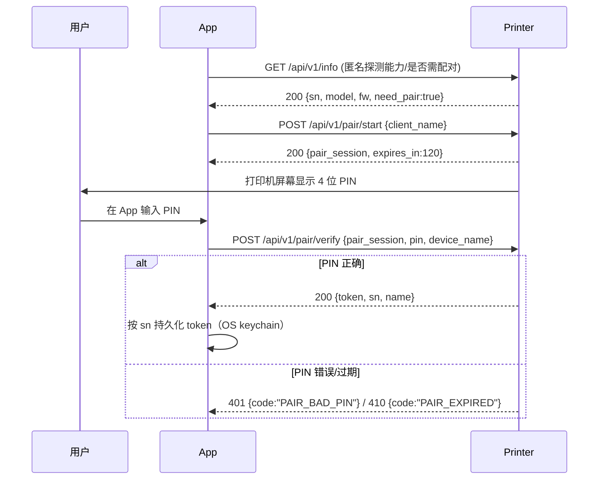
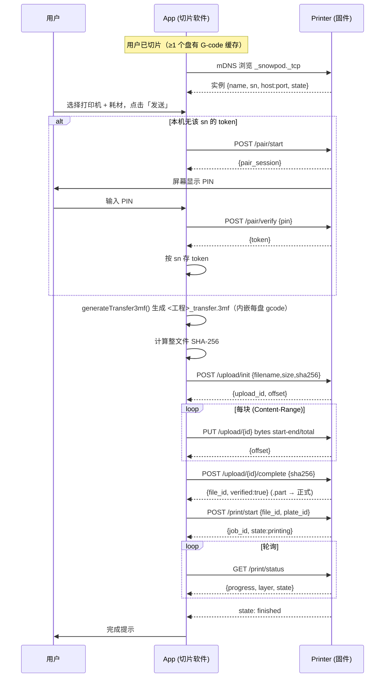

# WiFi 无线传输协议说明（WIFI-TRANSFER）

> 本文档定义 **Snowpath 切片软件（客户端 / App）** 与 **打印机固件（服务端 /
> Printer）** 之间，通过局域网 WiFi 把「切片好的打印任务」无线发送到打印机的
> 完整协议：设备发现、配对鉴权、传输数据格式、上传 / 打印 / 状态 REST 接口、
> 错误码、安全模型与职责划分。
>
> 本文已将早期所有「待定项」按**最小 / 最省事的 v1 方案**定稿（详见附录
> 变更说明）。标注 **【约定】** 的即为**最终默认值**，两端据此实现即可，无需
> 再确认。被降级的更强方案统一收进「§12 未来扩展（可选，非 v1）」。文末
> 「§11 现状与待办」严格按当前仓库代码描述哪些已具备、哪些仍是占位 / 待实现，
> 请勿据未实现部分写集成代码。

---

## 0. 一句话定位

- **客户端 = 切片软件**：负责建模摆盘、切片、生成「传输 3mf」（普通工程 +
  内嵌每盘 G-code），并作为 HTTP 客户端把文件**分块上传**到打印机、下发开始
  打印指令、轮询打印状态。
- **服务端 = 打印机固件**：负责通过 mDNS 广播自己、处理 PIN 配对并颁发
  Token、接收分块上传并校验落盘、执行打印、上报状态。
- **整体数据流**：`发现打印机 → (首次)PIN 配对拿 Token → 本地生成传输 3mf →
  分块上传并整体校验 → 下发开始打印 → 轮询状态直到完成`。

为什么这么分：切片是重算力 + 大内存任务，只能在桌面端做；打印机固件资源
受限，只承担「收文件 + 执行 + 报状态」。把已切片产物打包成自描述的传输
3mf 发过去，固件无需具备切片能力，也便于断点续传与校验。

---

## 1. 术语与角色

| 术语 | 含义 |
| --- | --- |
| **Client / App** | Snowpath 切片软件桌面端（本仓库 `app_framework`） |
| **Server / Printer** | 打印机固件，提供 mDNS + HTTP 服务端 |
| **Plate（盘）** | 一个打印床布局单元。多盘工程每盘独立切片，**每盘一份 G-code** |
| **传输 3mf** | 普通工程 3mf + 内嵌每盘 G-code 的特制 .3mf（见 §5），上传单元 |
| **PIN** | 打印机屏幕显示的一次性配对码（**【约定】4 位数字**），物理在场凭证 |
| **Token** | 配对成功后固件颁发的长期访问令牌，后续请求免再输 PIN |
| **Job（任务）** | 一次打印任务，服务端为每次上传 + 打印分配一个 `job_id` |
| **SN** | 打印机序列号，设备唯一标识 |

---

## 2. 概览与架构

```
┌──────────────────────────── 客户端（切片软件 / App）────────────────────────────┐
│  Layout::generateTransfer3mf ──> ProjectIO::saveTransfer3mf  (传输 3mf 生成)      │
│  SendPrintTaskDialog / PrinterPairDialog            (发送 / PIN 配对 UI)          │
│  [待实现] DeviceDiscovery (mDNS)  PrinterClient (REST)  FileUploader (分块上传)   │
└───────────────┬───────────────────────────────────────────────┬─────────────────┘
                │  ① mDNS 发现 (_snowpod._tcp)                    │  ③ HTTP REST
                │  ② PIN→Token 握手 (HTTP)                        │     上传/打印/状态
┌───────────────┴───────────────────────────────────────────────┴─────────────────┐
│                          服务端（打印机固件 / Printer）                            │
│  mDNS Responder   |  Pair/Token 服务   |  Upload 接收+校验+落盘  |  打印执行+状态  │
└──────────────────────────────────────────────────────────────────────────────────┘
```

- **传输层**：HTTP/1.1（局域网明文）。**【约定】** 固定服务端口 `8080`。v1
  不上 TLS，局域网内纯 HTTP + Token 鉴权即可（HTTPS 见 §12）。
- **数据编码**：控制类接口用 JSON（UTF-8）；文件上传用二进制 body +
  `Content-Range` 分块。
- **鉴权**：除发现与配对握手外，所有接口都需携带 `Authorization: Bearer
  <token>`。

---

## 3. 设备发现（mDNS / DNS-SD）

### 3.1 服务类型与实例

- **服务类型**：**【约定】** `_snowpod._tcp`（局域网 `.local` 域）。
- **实例名**：**【约定】** 取打印机用户可读名，例如 `Snowpod-A1 (lab)`；冲突
  时由 mDNS 标准自动追加 ` (2)`。
- **端口**：**【约定】** 固定 `8080`（SRV 记录照常给出，便于非默认部署，但
  v1 客户端默认按 8080 连接）。
- **主机名**：**【约定】** `snowpod-<sn>.local`，**暴露 SN**——`sn` 同时用于
  mDNS 区分设备与客户端 Token 存储键，不另设设备 id（局域网内可识别即可，
  见 §9 隐私说明）。

### 3.2 TXT 记录字段（键值，全部小写，**最小集**）

| Key | 示例 | 含义 |
| --- | --- | --- |
| `ver` | `1` | 协议版本（本文件 = 1） |
| `model` | `Snowpod A1` | 机型，UI 展示用 |
| `sn` | `SP1A23456789` | 序列号，设备唯一键（重连 / 去重 / Token 存储键） |
| `needpair` | `1` / `0` | 是否需要配对（`0` 表示本机已配过、可免 PIN） |

> **【约定】** TXT 仅这 4 个字段，固件版本 / 实时状态等不放进 TXT（需要时走
> `GET /info`，见 §4.2.1），保持广播包精简。客户端以 `sn` 作为设备身份主键来
> 匹配「已保存的 Token」，而非 IP（IP 会变）。

### 3.3 发现、下线与超时

- **发现**：客户端启动「发送到打印机」流程时开始浏览 `_snowpod._tcp`，把每个
  实例解析为 `{name, model, sn, host, port}` 填进打印机下拉（实时状态需要时再
  按 `GET /info` 拉取）。
- **下线**：收到 mDNS `goodbye`（TTL=0）或解析失败 → 从列表移除。
- **超时**：**【约定】** 浏览 5s 无响应仍允许手动刷新；某设备 30s 未刷新 TXT
  视为离线。
- **手动兜底**：**【约定】** UI 在打印机下拉旁提供「+ 手动添加」入口，输入
  `IP[:端口]`（端口缺省即 8080），跳过 mDNS 直接走 §6 的 HTTP 接口（应对
  mDNS 被路由器隔离 / 跨网段场景）。

> 上游可参考 `3rd/slice/slic3r/Utils/Bonjour.cpp` 的 mDNS 浏览实现作为客户端
> 发现侧的落地参考。

---

## 4. 配对与鉴权（PIN → Token）

### 4.1 流程



### 4.2 端点定义

#### 4.2.1 `GET /api/v1/info`（匿名，能力探测）

响应：

```json
{ "sn": "SP1A23456789", "model": "Snowpod A1", "fw": "1.4.2",
  "api_version": 1, "need_pair": true, "state": "idle" }
```

#### 4.2.2 `POST /api/v1/pair/start`（匿名，开始配对）

请求 body：

```json
{ "client_name": "Snowpath @ Alice-PC" }
```

响应（同时打印机屏幕显示 PIN）：

```json
{ "pair_session": "9f2c…", "expires_in": 120 }
```

#### 4.2.3 `POST /api/v1/pair/verify`（匿名，校验 PIN + 命名 + 颁发 Token）

**【约定】** 设备命名一并在本端点完成（**不单设 `PUT /name` 端点**）：客户端
把用户在「成功命名」态填的设备名 `device_name` 随校验请求一起提交，固件校验
PIN 通过后保存该别名并在响应里回带。

请求 body：

```json
{ "pair_session": "9f2c…", "pin": "1234", "device_name": "实验室-A1" }
```

成功响应（`name` = 固件最终采用的别名，通常即提交的 `device_name`）：

```json
{ "token": "eyJhbGci…(不透明长期令牌)", "sn": "SP1A23456789",
  "name": "实验室-A1" }
```

失败：`401 PAIR_BAD_PIN`（PIN 错，允许重试，**【约定】** 最多 5 次后锁定
`pair_session`）；`410 PAIR_EXPIRED`（会话超时，需重新 `pair/start`）。

> `device_name` 可选：客户端不命名时省略该字段，固件回退为 `model` 作为
> `name`。

### 4.3 Token 存储、免输与解除

- **存储**：客户端按 `sn → token` 存入 OS keychain（与 `docs/ONLINE-MODELS.md`
  的 token 存储一致原则，不落明文配置）。
- **免输**：下次发送，若本机已有该 `sn` 的有效 token，直接跳过 PIN 配对进入
  §6 上传。
- **失效**：任何业务接口返回 `401 AUTH_INVALID` → 客户端丢弃本地 token，回退
  到 §4.1 重新配对。
- **解除配对**：`POST /api/v1/pair/revoke`（带 Token）使当前 token 失效；
  打印机端「设置 → 解除已配对设备」也应能单方作废。**【约定】** 固件按
  `client_name` 保存多个 token（天然支持多客户端配对，无需客户端做 token
  管理 UI）；客户端侧只需在收到 `401 AUTH_INVALID` 时丢弃本地 token 重新配对。

### 4.4 与现有 PIN UI 的对齐

当前 `PrinterPairDialog` 已实现 4 状态 UI（输入 PIN → 搜索 → 成功命名 →
失败），但**是假实现**：PIN `== "1234"` 即视为正确、用本地 `QTimer` 模拟
3s「搜索」后转成功，无任何网络请求。落地时需把：

- 「搜索」态从 **假倒计时** 改成真正发 `pair/start` + 等待用户输入 + 发
  `pair/verify`；
- 「成功」态的「命名设备」**随 `pair/verify` 的 `device_name` 字段一起提交**
  （§4.2.3），不另调命名端点；以响应里的 `name` 为准展示；
- `paired(pin)` 信号语义改为「已拿到 token」，再继续 §6 上传。

---

## 5. 传输数据格式（传输 3mf）

### 5.1 精确结构

传输 3mf 是在普通工程 3mf 基础上，把每盘 G-code 作为额外 zip 条目嵌入。由
`ProjectIO::saveTransfer3mf()` 生成，其内部：① 先复用 `save3mf()` 写出**基础
工程**；② 再用 zip 续写机制（`appendZipEntries`）追加 G-code 条目。

```
<project>_transfer.3mf  (ZIP, zip64)
├── 3D/3dmodel.model                       ← 模型几何 + 变换（store_3mf 写）
├── _rels/ , [Content_Types].xml           ← 3MF 标准骨架
├── Metadata/snowpath.config               ← Snowpath 来源标识（自家工程标记）
├── Metadata/snowpath_plates.json          ← 多盘布局 + object→plate 映射
├── Metadata/snowpath_process.json         ← 工艺参数（ParamSystem 序列化，可空）
├── Metadata/snowpath_supports.json        ← 支撑持久化（可空）
├── Metadata/snowpath_truss.bin            ← truss 轨迹 blob（可空）
│   …（以及 textures / texts / groups 等其它 Snowpath sidecar，按需）
├── Metadata/plate_<盘id>.gcode            ← ★ 该盘 G-code 文本（传输 3mf 专属）
└── Metadata/plate_<盘id>.gcode.md5        ← ★ 上面字节的 MD5 校验（传输 3mf 专属）
```

- **G-code 条目**：`Metadata/plate_<盘id>.gcode`，`<盘id>` = Scene/PlateManager
  的盘 id（**注意：是盘 id，不一定从 1 连续**）。命名对齐 Bambu/Prusa「带
  gcode 的 3mf」习惯。
- **校验条目**：`Metadata/plate_<盘id>.gcode.md5`，内容 = 对应 `.gcode`
  **字节内容**的 **MD5，十六进制小写**（`QCryptographicHash::Md5` →
  `toHex()`）。**校验对象明确为 gcode 字节本身**，不含路径或其它元数据。
- **多盘**：每个「已切片」的盘生成一对 `(.gcode, .gcode.md5)`；未切片的盘不
  产出条目。
- **G-code 内容**：SLM 工艺文本，由 `Layout::writeGCodeFile()` 经
  `RSSlicer::emitGCodeLayer` 按层生成，文件头形如 `; SLM GCode - Snowpath`，
  含层数 / 层高 / 扫描速度 / 各段激光功率等注释。

> **【约定】** v1 **不写** `Metadata/print_manifest.json` 汇总清单：要打印哪个
> 盘，完全由 `Metadata/plate_<id>.gcode` 的命名约定 + `/print/start` 请求里的
> `plate_id` 指定，固件按盘号直接定位条目即可，无需额外索引文件。汇总清单作为
> 未来可选优化见 §12。

### 5.2 与普通另存 3mf 的区别

| | 普通工程 3mf（`save3mf`） | 传输 3mf（`saveTransfer3mf`） |
| --- | --- | --- |
| 模型 + 变换 + 多盘 + sidecar | ✅ | ✅（完全复用） |
| `Metadata/plate_*.gcode` (+ `.md5`) | ❌ 不含 | ✅ 每盘一份 |
| 用途 | 工程存档 / 再编辑 | 发送到打印机执行 |
| 落盘位置 | 用户选择的工程路径 | 缓存目录 `<Cache>/transfer/<工程名>_transfer.3mf` |

普通保存语义**不变**（不含 gcode）；传输 3mf 是独立新增产物。

### 5.3 前置校验

`saveTransfer3mf` 在写盘前强制：`plateGcodes` 非空、且**每盘 gcode 非空**。
否则直接失败并写 `errorOut`（"尚未切片，无可嵌入的 G-code"），**绝不**写出
一个没有 gcode 的「传输 3mf」。基础 3mf 已写好但 gcode 追加失败时，删除半成品
文件。

---

## 6. 传输协议（HTTP REST）

所有接口基路径 **【约定】** `/api/v1`；除 §4 配对外均需
`Authorization: Bearer <token>`。

### 6.1 上传（分块 + 断点续传 + 整体校验 + 原子落盘）

设计与客户端现有 `FileDownloader`（§见参考）**对称**：分块、续传、整体哈希、
进度、`.part → 正式` 原子落盘——只是方向相反（上传）。

#### 6.1.1 创建上传会话 `POST /api/v1/upload/init`

请求：

```json
{ "filename": "demo_transfer.3mf",
  "size": 10485760,
  "sha256": "<整文件 SHA-256 hex 小写>",
  "kind": "transfer_3mf" }
```

响应：

```json
{ "upload_id": "u_8123", "offset": 0, "chunk_max": 4194304 }
```

- `offset` = 服务端**已收到的字节数**（断点续传基线）。新会话为 0；若客户端
  用同一 `sha256` 重新 init，服务端可返回上次进度的 `offset` 实现跨重启续传
  （**【约定】** 服务端以 `sha256` 作为去重 / 续传键）。
- `chunk_max` = 单块字节上限（**【约定】** 默认 4 MiB）。

> **【约定】** 整文件完整性用 **SHA-256**（与 `FileDownloader` 一致，更强）；
> 传输 3mf 内每盘 gcode 另有 **MD5**（§5）供固件落盘后单盘校验。两者并存、
> 用途不同。

#### 6.1.2 上传分块 `PUT /api/v1/upload/{upload_id}`

Header：

```
Authorization: Bearer <token>
Content-Range: bytes <start>-<end>/<total>
Content-Type: application/octet-stream
```

Body：该区间的原始字节。

响应（每块）：

```json
{ "offset": 4194304 }      // 服务端当前已落盘的累计字节（= 下一块的 start）
```

- 客户端按 `offset` 顺序推进；网络中断后重新 `upload/init`（或直接 `GET
  upload/{id}/status`）拿最新 `offset` 续传。
- 服务端把分块写入 `<filename>.part`（**临时**），记录已收字节。

#### 6.1.3 完成并校验 `POST /api/v1/upload/{upload_id}/complete`

请求：

```json
{ "sha256": "<整文件 SHA-256 hex 小写>" }
```

服务端对 `.part` 整体算 SHA-256：
- 匹配 → **原子 rename** `.part → 正式文件`，返回 `200`：

```json
{ "file_id": "f_5566", "size": 10485760, "verified": true }
```

- 不匹配 → 删除 `.part`，返回 `422 CHECKSUM_MISMATCH`，客户端需重传。

#### 6.1.4 查询上传进度 `GET /api/v1/upload/{upload_id}/status`

```json
{ "offset": 8388608, "size": 10485760, "state": "receiving" }
```

> **进度**：客户端上传进度 = `已发送字节 / total`（续传时叠加初始 `offset`），
> 与 `FileDownloader` 的进度叠加逻辑对称。

### 6.2 开始打印 `POST /api/v1/print/start`

请求（指定已上传文件 + 盘号）：

```json
{ "file_id": "f_5566", "plate_id": 1, "material": "耗材-002" }
```

- `plate_id` 对应传输 3mf 内 `Metadata/plate_<plate_id>.gcode`。固件据此取出
  该盘 gcode 执行；落盘前**用同名 `.gcode.md5` 校验**该盘字节。
- 响应：

```json
{ "job_id": "j_9001", "state": "printing", "plate_id": 1 }
```

- 错误：`409 PRINTER_BUSY`（已有任务在打印）；`404 FILE_NOT_FOUND`；
  `422 PLATE_NOT_IN_FILE`（盘号在文件里无对应 gcode）。

### 6.3 查询状态 / 进度 `GET /api/v1/print/status`

**【约定】** v1 **只采用客户端轮询**（实现简单、固件无需维持长连接），不做
WebSocket / SSE 推送（列入 §12 未来可选）。轮询间隔建议 1–2 s，打印中可放宽到
5 s。

```json
{ "job_id": "j_9001", "state": "printing",
  "progress": 0.42, "layer": 128, "layer_total": 305,
  "elapsed_s": 540, "remaining_s": 720,
  "nozzle_temp": 0, "bed_temp": 0, "error": null }
```

`state` 取值 **【约定】**：`idle | uploading | printing | finished | canceled |
error`（v1 不含 `paused`，暂停 / 恢复见 §12）。

### 6.4 取消打印 `POST /api/v1/print/cancel`

```json
{ "job_id": "j_9001" }
```

→ 终止当前任务并清理，响应 `200 {"job_id":"j_9001","state":"canceled"}`。

> **【约定】** v1 仅支持取消，**不含暂停 / 恢复**（`print/pause`、`print/resume`
> 列入 §12 未来可选，取决于固件运动控制能力）。

---

## 7. 完整时序（端到端）



---

## 8. 错误处理与状态码

HTTP 状态码用语义层（4xx 客户端 / 鉴权 / 校验，5xx 服务端）；body 统一带
`code`（机器可读）+ `message`（可读）。客户端内部任务码沿用 `FileDownloader`
风格（负数为本地 / 传输层错误）。

### 8.1 HTTP 业务错误码（body.code）

| HTTP | code | 含义 / 客户端动作 |
| --- | --- | --- |
| 401 | `AUTH_INVALID` | Token 失效 → 丢弃本地 token，回到配对 |
| 401 | `PAIR_BAD_PIN` | PIN 错 → 允许重试（达上限锁定会话） |
| 410 | `PAIR_EXPIRED` | 配对会话超时 → 重新 `pair/start` |
| 404 | `FILE_NOT_FOUND` | file_id 不存在 → 重新上传 |
| 409 | `PRINTER_BUSY` | 打印机忙 → 提示用户稍后 |
| 413 | `FILE_TOO_LARGE` | 超出固件存储 → 提示，必要时减层/分盘 |
| 422 | `CHECKSUM_MISMATCH` | 整文件 SHA-256 不符 → 重传 |
| 422 | `PLATE_NOT_IN_FILE` | 盘号无对应 gcode → 校验 plate_id |
| 507 | `DISK_FULL` | 固件磁盘满 → 提示清理 |
| 503 | `PRINTER_NOT_READY` | 预热 / 维护中 → 稍后重试 |

### 8.2 客户端本地 / 传输层码（沿用 FileDownloader 约定）

| code | 含义 |
| --- | --- |
| `>0` | 等于 HTTP 状态码（服务器拒绝 / 内容错误） |
| `-1` | 网络断 / DNS / TLS 失败 |
| `-2` | 本地 I/O 失败（读传输 3mf / 写临时） |
| `-100` | 完整性校验失败（SHA-256 / MD5 不符） |
| `-102` | 用户取消 |
| `-200` | **【约定】** 未切片 / 无可发送盘（`generateTransfer3mf` 失败） |

---

## 9. 安全

- **Token 鉴权**：除发现 / 配对外，所有接口校验 `Bearer token`；失效即强制
  重新配对。
- **PIN 物理在场**：PIN 仅显示在打印机屏幕，确保发起配对者**物理接触**该设备，
  防止同网陌生人盲配；PIN 一次性、短时效（120 s）、错误次数上限。
- **传输加密**：**【约定】** v1 **不上 TLS**，局域网内纯 HTTP + Token 鉴权。
  明文 HTTP 在不可信 WiFi 上可被嗅探，这是 v1 为最小实现接受的折中；可选
  HTTPS（固件自签证书 + 客户端 TOFU 固定指纹）列入 §12 未来增强。
- **局域网风险与缓解**：
  - 上传体积上限 + 频率限制，防止 DoS 塞满固件存储。
  - Token 仅授权打印相关操作，不暴露固件文件系统 / shell。
- **隐私**：**【约定】** mDNS 通告与主机名**暴露 SN**（`sn` 既作设备区分键、
  也作客户端 Token 存储键，不另设设备 id）。SN 仅在局域网内可见，作为最小
  实现接受的折中。

---

## 10. 客户端 vs 服务端职责划分

| 能力 | 客户端（App） | 服务端（固件） |
| --- | --- | --- |
| mDNS | 浏览 / 解析 | 广播 `_snowpod._tcp` + TXT |
| 配对 | 输入 PIN、存 Token | 显示 PIN、校验、颁发 / 吊销 Token |
| 传输 3mf | **生成**（已实现，§5/§11） | 接收 / 解析（取盘 gcode） |
| 上传 | 分块 + 续传 + 整体 SHA-256 + 进度 | 落盘 `.part`、记录 offset、整体校验、原子 rename |
| 单盘 gcode 校验 | 写入 `.gcode.md5`（已实现） | 执行前用 `.md5` 校验该盘字节 |
| 打印控制 | 下发 start / cancel | 执行运动控制、状态机 |
| 状态 | 轮询展示进度 | 上报 progress / layer / temp / error |

---

## 11. 现状与待办（落地映射，严格按当前代码）

### 11.1 已具备（仓库中已实现）

- **传输 3mf 生成**：
  - `ProjectIO::saveTransfer3mf(path, scene, QVector<PlateGcode>, errorOut,
    processConfigJson, trussBlob)`（`app_framework/services/ProjectIO.cpp`）——
    复用 `save3mf` 写基础工程，再用 `appendZipEntries` 追加
    `Metadata/plate_<id>.gcode` + `.gcode.md5`（gcode 字节的 MD5 hex 小写）。
    含前置校验（空 gcode 直接失败、不产无 gcode 的传输 3mf）。
  - `struct ProjectIO::PlateGcode { int plateId; QByteArray gcode; }`。
  - `Layout::generateTransfer3mf(QString* errorOut)`
    （`app_framework/viewport/Layout.cpp`）—— 收集已切片的盘（激活盘取 live
    缓存 `m_layerPreview*`，其它盘取 `m_plateSliceCaches`），逐盘经
    `writeGCodeFile()` 写到 `QTemporaryDir` 读字节，调 `saveTransfer3mf`，
    产物落 `<CacheLocation>/transfer/<工程名>_transfer.3mf`，返回路径或空串。
  - **多盘 = 每盘一份 gcode**，与「导出全部盘」`exportAllPlates` 同口径。
- **G-code 生成**：`Layout::writeGCodeFile()` 经 `RSSlicer::emitGCodeLayer`
  按层产出 SLM 文本（头 `; SLM GCode - Snowpath`）。
- **发送 / 配对 UI 壳**：
  - `SendPrintTaskDialog`（模型图 / 打印机 / 耗材下拉 / 发送按钮）——
    下拉项目前是**硬编码占位**（`Snowpod A0/A1/A2`、`耗材-001…`）。
  - 点「发送」→ `PrinterPairDialog`（4 位 PIN 四状态 UI）→ `paired` →
    `Layout` 槽现在**已调用 `generateTransfer3mf`**，成功则弹出传输文件路径
    占位提示（无真实上传）。
- **下载客户端范式（对称参考，可复用设计）**：
  `app_framework/services/net/FileDownloader.{h,cpp}` —— HTTP Range 续传 +
  SHA-256 边传边算 + `.part` 原子落盘 + 进度 + 错误码约定。上传客户端
  （`FileUploader`）应镜像它。

### 11.2 占位 / 假实现（需替换）

- `PrinterPairDialog` 的「搜索」是本地 `QTimer` 假倒计时，PIN `=="1234"` 即
  成功，**无任何网络**。需替换为 §4 的 `pair/start` + `pair/verify` 真握手。
- `SendPrintTaskDialog` 打印机 / 耗材下拉是写死列表，需接 mDNS 发现结果 /
  耗材库。
- 发送成功后仅 `QMessageBox` 弹出传输文件路径，**没有真实上传 / 开始打印**。

### 11.3 待实现清单（建议分阶段）

**阶段 A — 打通最小可用链路（局域网明文）**
1. 客户端 `DeviceDiscovery`（mDNS 浏览 `_snowpod._tcp`，可参考
   `3rd/slice/slic3r/Utils/Bonjour.cpp`），结果填 `SendPrintTaskDialog` 下拉。
2. 客户端 `PrinterClient`（REST）：`info / pair/start / pair/verify`，Token
   按 `sn` 存 keychain；改造 `PrinterPairDialog` 走真握手。
3. 客户端 `FileUploader`（镜像 `FileDownloader`）：`upload/init` → 分块 `PUT`
   （Content-Range）→ `complete`（SHA-256）→ 进度 / 续传 / 取消。
4. 客户端 `print/start` + `print/status` 轮询，接进度 UI。
5. 固件侧服务端：mDNS responder + 上述端点 + `.part` 落盘 / 校验 / 执行。

**阶段 B — 健壮性与体验**
6. 手动输 IP 兜底（「+ 手动添加」入口，端口缺省 8080）；断点续传跨重启；
   错误码全表对接 §8。

> v1 范围到此为止。下列更强方案均**不在 v1**，见 §12。

---

## 12. 未来扩展（可选，非 v1）

以下为本次定稿时被降级、留作后续迭代的更强方案，v1 一律不实现：

1. **HTTPS / TLS**：固件自签证书 + 客户端首次配对 TOFU 固定证书指纹，加密
   局域网传输（替代 v1 的纯 HTTP，§2 / §9）。
2. **状态推送**：WebSocket / SSE 替代轮询，降低延迟与请求量（§6.3）。
3. **暂停 / 恢复**：`POST /print/pause`、`POST /print/resume` 及 `paused`
   状态（§6.4），取决于固件运动控制能力。
4. **`Metadata/print_manifest.json`**：传输 3mf 内汇总「盘列表 + 每盘 gcode
   路径 + md5 + 预估时长 / 重量」，便于固件不解压全部即可索引（§5.1）。
5. **Token 多客户端管理 UI**：客户端列出 / 吊销本机在各打印机上的配对
   （v1 仅固件侧按 `client_name` 多 token 共存，客户端不做管理界面，§4.3）。
6. **更丰富的 mDNS TXT**：如 `fw` / `state` 等（v1 走 `GET /info` 获取，§3.2）。

---

## 附录 A：版本

| 版本 | 日期 | 变更 |
| --- | --- | --- |
| v1 (draft) | 2026-06-24 | 首版：发现 / 配对 / 传输 3mf / 上传 / 打印 / 状态 协议定义；现状映射 |
| v1 (定稿) | 2026-06-24 | 将早期全部「待定项」定为最小 v1 方案：端口固定 8080、TXT 最小集（model/sn/ver/needpair）、暴露 SN、命名并入 `pair/verify`、状态仅轮询、仅保留 cancel（去 pause/resume）、不写 manifest、不上 TLS；被降级方案统一收入 §12 |
