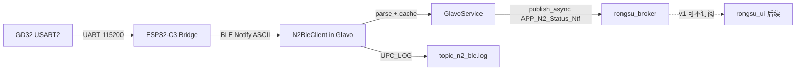

# 制氮机 BLE（SoC 侧）设计方案

**已定**：`1A` 放在 `rongsu_glavo`；`2B` 第一期只做 BLE 连接 + 解析 + IPC/日志，**不做 UI、不做打印门控**。

依据：[doc/制氮机mcu对接soc-协议说明.md](doc/制氮机mcu对接soc-协议说明.md)。

---

## 已实现功能（v1，2026-09-18 板端已跑通）

**要不要上屏？现在不要。** 拿到氮气值后 **不显示在 LVGL 屏幕上**，首页/设置页都没改。Glavo 只把快照 `publish_async` 给 Broker（目标 UI），UI **未订阅** `APP_N2_Status_Ntf`。看数值用日志，不是看屏幕。二期再订消息、改页面。

当前 SoC 实际做了这些：

| 能力 | 说明 |
|------|------|
| 后台扫描 | `rongsu_glavo` 启动后独立线程扫 BLE，目标广播名 `N2_Machine`（Service `0x4FFC` 作辅助匹配） |
| 连接 | BlueZ D-Bus GATT Client；本板 `Connect`/`Disconnect` 带 ADDR_TYPE（`public`/`random`），失败再回退上游空参 |
| 收状态 | 特征 `0x1B9A` 开 Notify；Notify 空档可用 READ |
| 解析 | ASCII：`N2=` / `STATE=` / `seq=`。`N2=warming` / `N2=waiting` → `n2_valid=0`，不当浓度 |
| 在线判定 | 已连接且约 5s 内有数据为 online；超时或断线 → offline，退避重扫 |
| 进程内快照 | `online`、`n2_valid`、`n2_percent`、`state`、`seq`、最近 ASCII |
| IPC | `MsgType::APP_N2_Status_Ntf`（`0x1620`）+ `N2StatusPayload`；变化立即推，否则最多 1Hz；目标 `ModuleId::UI` |
| 日志 | `/var/log/topic/topic_n2_ble.log`（例：`ascii=N2=100.00% STATE=WARMUP seq=177`） |
| 空跑 | 无 libdbus：`UPC_GLAVO_HAS_BLUEZ=0`，Warn 后不拖垮 Glavo。`GLAVO_N2_BLE_ENABLE=0` 不启线程 |

代码：`app/glavo/lib/n2_ble_parse.*`（可单测）、`n2_ble_transport.*`、`n2_ble_client.*`；`GlavoService::init`/`stop` 启停。契约：`common/upc_contract.hpp`、`COMMON.md`。

**明确没做：** 屏幕显示、打印门控、告警、MQTT 上云、SoC→设备命令。  
`100.00%` + `STATE=WARMUP` 是氧预热，不要当稳态浓度；就绪后应变 `STATE=RUN`。

跟日志：

```bash
adb -s <板IP:5555> shell "tail -f /var/log/topic/topic_n2_ble.log"
```

---

## 链路与边界



- SoC 只做 **BLE GATT Client**；不碰 GD32 二进制帧，不发下行命令。
- **不新建进程**；**不把 N₂ 塞进**现有 `EnvSnapshotPayload`（与串口舱内 O₂ 不是同一源，且有 `warming`/`waiting`）。
- 风格对齐现有 `WifiManager`：独立线程，业务侧拿快照 / 经 worker 发 IPC。

---

## Glavo 模块

新增 `app/glavo/lib/n2_ble_client.*`：

| 职责 | 行为 |
|------|------|
| 扫描/连接 | 广播名 `N2_Machine`；辅助过滤 Service `0x4FFC` |
| GATT | 特征 `0x1B9A`，开 Notify；可选 READ |
| 解析 | `N2=` / `STATE=` / `seq=`；`warming`/`waiting` → 无效浓度 |
| 在线 | 连接态 + 约 5s 无 Notify → offline |
| 推送 | 变化立即推；否则最多 1Hz |
| 重连 | 断线退避重扫 |

快照字段：`online`、`n2_valid`、`n2_percent`、`state`、`seq`、最近 ASCII。

**蓝牙栈**：默认 **BlueZ + D-Bus GATT Client**。封装 `N2BleTransport`，解析与 D-Bus 分离。无 BlueZ 时 `UPC_GLAVO_HAS_BLUEZ=0` 空跑 + Warn，不拖垮 Glavo。

接入：`GlavoService::init` 启 `N2BleClient` 线程；`stop` 时 shutdown。文件：`n2_ble_parse.*` / `n2_ble_transport.*` / `n2_ble_client.*`。细节见上文「已实现功能（v1）」。

---

## 消息契约（COMMON 四步）

在 `upc_contract.hpp` 新增：

- `MsgType::APP_N2_Status_Ntf`
- `N2StatusPayload`：`online` / `n2_valid` / `n2_percent` / `state` / `seq` / 时间戳

同步 `COMMON.md` + 专题日志 `topic_n2_ble.log`。

v1：Glavo **已** `publish_async` 到 UI；UI **暂不订阅、不改页面**，二期只接回调即可。

---

## 明确不做（v1）

- UI 显示、打印门控、告警码、MQTT 上云  
- SoC→设备命令  
- WiFi/BT 共芯片深度调优（仅记录冲突现象）

---

## 验证与文档

- ASCII 解析表驱动用例  
- 板端连真实 `N2_Machine` 看日志；断连约 5s 见 offline  
- 无设备时 Glavo 正常启动  
- k1mini / PHX 交叉编译通过  
- 更新 `GLAVO.md`、`ARCHITECTURE.md`、协议说明 SoC 索引  

应用代码前，先按下一节在 SoC **shell** 上确认蓝牙栈和真机 Notify（不是电脑 VOFA 串口）。

---

## 板端蓝牙探测与真机验证

命令全部在 **主机 SoC** 上执行（ADB / 调试串口进 Linux）。电脑 USB 串口连的是 console 或 MCU 协议口，**不是** 这条 BLE。

### 实测环境（2026-09-18）

| 项 | 值 |
|----|-----|
| 板 | RK3568 Buildroot（例：ADB `172.17.101.220:5555`） |
| 模组 | USB **AICSemi AIC 8800D80**（`a69c:8d81`），WiFi/BT 共芯片 |
| 驱动 | `aic_btusb`；`/sys/class/bluetooth/hci0` |
| 栈 | BlueZ **5.77**，`bluetoothd` 在跑；D-Bus `org.bluez` |
| 控制器 | `hci0` UP RUNNING，HCI/LMP **5.4**，地址 `50:37:CD:E0:B2:F5`，角色 central+peripheral |
| 工具 | `hciconfig` / `bluetoothctl` / `gatttool` / `btmon` |
| 扫到 | 广播名 **`N2_Machine`**，地址 **`E8:3D:C1:22:D6:4A`**，RSSI 约 **-60 dBm** |

地址以当次 `scan` 为准，换机可能变。结论：本板可用 **BlueZ + D-Bus GATT Client**，不必走 `UPC_GLAVO_HAS_BLUEZ=0` 空跑。

### A. 确认硬件、驱动、用户态（不连制氮机也能做）

电脑：

```bash
adb devices -l
adb -s <板IP:5555> shell
```

板子上按「节点 → 驱动 → BlueZ → 扫描」：

```bash
# 1) 有没有控制器
ls -l /sys/class/bluetooth
# 期望：hci0

# 2) 驱动
lsmod | grep -iE 'bt|hci|blue'
# 本板期望：aic_btusb

dmesg | grep -iE 'Bluetooth|hci0|aic_btusb'
# 期望：Bluetooth: MGMT ...

cat /sys/bus/usb/devices/4-1/idVendor
cat /sys/bus/usb/devices/4-1/idProduct
cat /sys/bus/usb/devices/4-1/manufacturer
cat /sys/bus/usb/devices/4-1/product
# 本板：a69c / 8d81 / AICSemi / AIC 8800D80（USB 口编号以实际 sysfs 为准）

# 3) 用户态
hciconfig -a
# 期望：hci0  Type: Primary  Bus: USB  且 UP RUNNING

ps | grep bluetoothd
bluetoothctl show
# 期望：Powered: yes；Roles 含 central
```

再确认 **能扫到设备**（射频真正在收）：

```bash
bluetoothctl --timeout 6 scan on
```

成功示例：

```text
[NEW] Device E8:3D:C1:22:D6:4A N2_Machine
```

到这里只证明扫描。连接、开 Notify、读 ASCII 见 B。

### B. 连真机：本板 `bluetoothctl connect` 不可用

RK 这套 BlueZ **改过 D-Bus**：`org.bluez.Device1.Connect` 的签名是 **`s`（地址类型）**，不是上游的空参数。  
`bluetoothctl` 仍调 `Connect()`，所以会稳定报：

```text
Failed to connect: org.freedesktop.DBus.Error.UnknownMethod
Method "Connect" with signature "" on interface "org.bluez.Device1" doesn't exist
```

这不是 MAC 错、也不是没扫到。`info` 能看到设备时，用 `dbus-send` 带 `public`/`random` 连接。

先 `scan on` 等到 `N2_Machine`（**先不要 `scan off`**），另开一个 shell（或退出 bluetoothctl）执行：

```bash
# 先确认对象在（应有 Name: N2_Machine，AddressType: public）
bluetoothctl info E8:3D:C1:22:D6:4A

dbus-send --system --print-reply --dest=org.bluez \
  /org/bluez/hci0/dev_E8_3D_C1_22_D6_4A \
  org.bluez.Device1.Connect string:public
```

成功是 `method return`（没有 Error）。再：

```bash
bluetoothctl info E8:3D:C1:22:D6:4A
# Connected: yes
# UUID 里应有 00004ffc-...
```

若 `info` 写的是 `AddressType: random`，把上面的 `string:public` 改成 `string:random`。

2026-09-18 实测：`Connect string:public` 成功；GATT 上已有 `0x4FFC` / `0x1B9A`；READ 到：

```text
N2=100.00% STATE=WARMUP seq=185
```

（浓度数字 + `WARMUP` 表示氧预热，按协议不要当稳态浓度。）

然后进 `bluetoothctl` 做 GATT（GATT 接口仍是上游签名，`read` / `notify` 可用）：

```text
menu gatt
list-attributes
select-attribute /org/bluez/hci0/dev_E8_3D_C1_22_D6_4A/service000e/char000f
attribute-info
notify on
read
```

`service000e` / `char000f` 以当次 `list-attributes` 为准。期望特征 UUID `00001b9a-...`。

结束断开也要用带类型的接口（`bluetoothctl disconnect` 可能同样 UnknownMethod）：

```bash
dbus-send --system --print-reply --dest=org.bluez \
  /org/bluez/hci0/dev_E8_3D_C1_22_D6_4A \
  org.bluez.Device1.Disconnect string:public
```

应用代码不要用 `bluetoothctl`，走 D-Bus 时 **Connect/Disconnect 必须带 ADDR_TYPE 字符串**。

### C. 同一件事用 `gatttool`（看 handle）

新 BlueZ 以 `bluetoothctl` 为准；`gatttool` 便于对照 CCCD：

```bash
hcitool lescan          # 可选；Ctrl+C 停
gatttool -b E8:3D:C1:22:D6:4A -I
```

```text
connect
primary
characteristics
char-read-uuid 1b9a
char-write-req <CCCD的handle> 0100
```

`0100` = 小端打开 Notify。CCCD 一般是 `0x1B9A` value handle 后的 `0x2902` 描述符。Notification 的 hex 按 ASCII 解读即 `N2=...`。

`disconnect` → `exit`。

### D. 对照协议：这一步在验证什么

| 步骤 | 协议项 | 成功表现 |
|------|--------|----------|
| 扫到 `N2_Machine` | 广播名 | 名字对上 |
| `connect` | BLE 连接 | `Connection successful` |
| `0x4FFC` / `0x1B9A` | Service / Char | `list-attributes` 可见 |
| `notify on` | CCCD | 开始周期性推送 |
| `N2=` / `STATE=` / `seq=` | ESP ASCII | **不是** `5A A5 BB...` |

SoC **收不到** GD32 的 15 字节帧；那是 ESP 内部的。见 [制氮机mcu对接soc-协议说明.md](doc/制氮机mcu对接soc-协议说明.md)。

### E. 常见卡住点

| 现象 | 先查 |
|------|------|
| 扫不到 | 制氮机没上电 / 太远；`scan on` 再等几秒 |
| `Connect` signature `""` 不存在 | **本板 bluetoothd 改过接口**。不要用 `bluetoothctl connect`；用 `dbus-send ... Device1.Connect string:public` |
| 停扫后 `info` 没有设备 | 未配对 LE 会在 `scan off` 后被删。先 `scan on` 再 Connect |
| `gatttool` Device busy | `bluetoothd` 已经占着连接，改用 `bluetoothctl` GATT 或先 Disconnect |
| 连上无 Notify | 没选 `0x1B9A`，或没 `notify on`（未开 CCCD 不推） |
| 只有 `N2=waiting` | ESP 还没从 GD32 UART 收到有效帧，查 MCU 串口，不是 SoC 蓝牙 |
| WiFi 短时异常 | AIC 8800D80 共芯片；v1 只记录，不做深度调优 |

---

